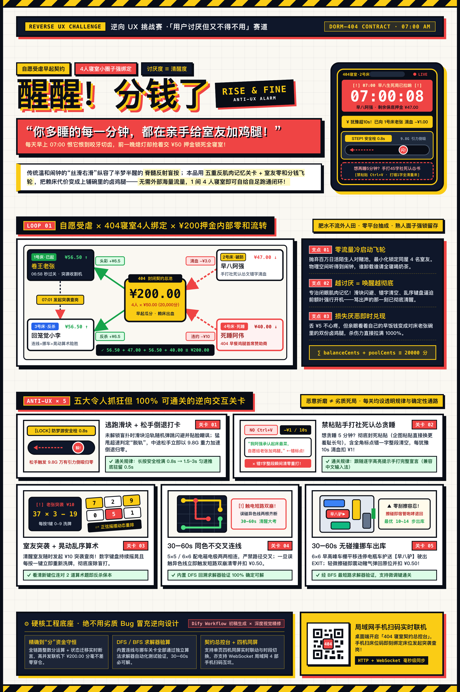

# 《醒醒！分钱了》Rise & Fine

> **你多睡的每一分钟，都在亲手给室友加鸡腿。**

一个把「起床」变成契约的闹钟。四个室友各押 ¥50 凑成 ¥200 的当日池子，谁赖床，钱就当场流进早起者的口袋。没有广告、没有会员、没有积分——只有真金白银在室友之间流转。

**这是一个可以直接打开就玩的产品，不是演示视频。**

---

## 立刻体验

三个版本，双击即可，支持 Mac / Windows / 手机浏览器，离线也能跑。

| 版本 | 文件 | 适合谁 |
| --- | --- | --- |
| **寝室总控台版** | [`醒醒分钱了-寝室总控台版.html`](醒醒分钱了-寝室总控台版.html) | 想一屏看懂全寝室：左边手机实况、右边账本与结算 |
| **单部手机版** | [`醒醒分钱了-单部手机版.html`](醒醒分钱了-单部手机版.html) | 只关心「我自己起床有多难」，沉浸单机 |
| **4 部联机同屏版** | [`醒醒分钱了-4部联机手机同屏版.html`](醒醒分钱了-4部联机手机同屏版.html) | 想看四个人互相伤害的全过程 |

> 手机上打开同屏版时，建议横屏或缩放到合适大小。

### 四人真机联机（路演 / 聚会现场最带感）

1. 四个人的手机连同一个 Wi-Fi 或热点（发起联机的那台电脑需装 Node.js；没装也能用，脚本会自动回退到离线同屏版）；
2. Mac 双击 [`一键启动局域网联机服务.command`](一键启动局域网联机服务.command)，Windows 双击 [`一键启动局域网联机服务-Windows.bat`](一键启动局域网联机服务-Windows.bat)；
3. 浏览器自动打开总控台，屏幕上给出 1–4 号床专属二维码；
4. 各自扫码，进入自己的手机界面。谁手滑扣款、谁认怂打错字、谁被突袭查岗，全寝室瞬间同步。

断网、断服务都不影响单机玩法——数据只在你们自己的局域网里流动，不上传任何服务器。

---

## 为什么它比普通闹钟管用

**普通闹钟只让你损失时间；早上八点的时间，人是不当钱的。让室友拿走你的钱，才疼。**

- **不靠自律，靠熟人**：跑步 App 靠打卡，靠不住就退坑；室友赖不掉——你们在同一个屋子里吃早饭。
- **零和市场，不需要流量**：四个人就是一个完整市场，钱一分不出房间。
- **每一关都在对付「半梦半醒的大脑」**：人在刚醒时只有肌肉记忆，所以我们把「关掉闹钟」这条路堵死。

---

## 五道关卡（每一道都为了让你真的睁眼）

1. **逃避重力滑块** —— 拇指追不上它，它躲。
2. **社死认怂书** —— 一字不差打完一段自我羞辱，粘贴被禁用；每磨蹭 10 秒扣 ¥1「犹豫税」。
3. **不交叉连线** —— 同色相连、异色不碰，碰线即短路重来。
4. **早高峰挪车** —— 6×6 车棚，把车挪出库且不许剐蹭。
5. **室友突袭查岗** —— 你的室友在自己手机上按一个键，你这边立刻弹出持续漂移的乱序算术键盘。

关卡全过 → 你吃掉全寝今天的钱；任意一关崩掉 → 你今天的早饭钱进别人碗里。

---

## 钱怎么算

- 每人每晚押 ¥50，四人共 ¥200 进入当日池子；
- 结算按「有效起床」分配，**池子总额永远等于 ¥200，一分不多一分不少**（每张结算单都盖守恒审计章）；
- 扣罚明码标价：滑块脱手 / 连线短路 ¥0.50，认怂书犹豫税 ¥1.00/10 秒，赖床每拍 ¥1.00，被室友突袭查岗 ¥10.00；
- 每天清零，第二天重新立约——昨天的账不滚到今天。

---

## 宣传素材

| 素材 | 文件 |
| --- | --- |
| 宣传片（50 秒 · 1080P） | [`宣传视频/醒醒分钱了-宣传片-1080P.mp4`](宣传视频/醒醒分钱了-宣传片-1080P.mp4) |
| 视频封面 | [`宣传视频/封面-1280x720.jpg`](宣传视频/封面-1280x720.jpg) |
| 海报（中文） | [`宣传海报/poster-final.pdf`](宣传海报/poster-final.pdf) |
| 海报（英文） | [`宣传海报/poster-final-en.pdf`](宣传海报/poster-final-en.pdf) |
| 海报（中英双语） | [`宣传海报/poster-final-bilingual.pdf`](宣传海报/poster-final-bilingual.pdf) |
| 海报源图（PNG） | [`宣传海报/高清PNG导出图/`](宣传海报/高清PNG导出图) |

---

## 常见问题

**室友直接卸载 App 怎么办？**
押金在池子里，卸载等于当日全损——这是唯一比赖床更贵的选项。

**室友找人代打呢？**
代打的人也要在同一个寝室、同一部手机上完成五道关卡；并且突袭查岗由室友发起，你无法预演。

**会不会伤感情？**
金额上限固定在每人 ¥50，且只在一个寝室内部流转——它制造的是每天早上的赌局，不是债务。

**需要注册账号、上传数据吗？**
不需要。没有账号、没有云端，联机只在你自己的局域网内。

**能只一个人用吗？**
可以。单部手机版就是纯单机模式，只是少了「钱真的会被人拿走」的痛感。

---

## 联系

合作、试用、寝室定制：欢迎开 Issue 或直接联系我们。

Rise & Fine — an alarm clock that costs money, not noise. Four roommates, one ¥200 pool, five puzzles built for a half-awake brain. Sleep in, and you buy their breakfast.
